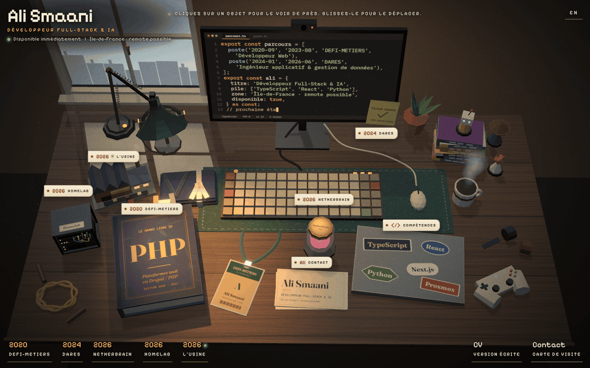

# cv_desktop

Le CV d'Ali Smaani sous la forme d'un bureau en 3D low poly : les objets posés sur le plateau portent le CV, on les prend en main, on les retourne, on les fait glisser.

En ligne sur **[alismaani.fr](https://alismaani.fr)**, avec une [version express](https://alismaani.fr/fr/express) qui donne le même CV en une page HTML, pour le lecteur pressé et les moteurs de recherche.



## Ce qui compte techniquement

- **Une seule source de contenu** : le CV en FR et en EN, typé et validé par zod au build, lu à la fois par la scène 3D et par la version express.
- **Scène React Three Fiber chargée à part** : la page s'affiche tout de suite (HUD et CV dans le HTML du serveur), three.js n'est pas dans le JavaScript initial, et un écran de chargement suit l'avancement réel.
- **Physique Rapier** chargée après l'arrivée : tout le bureau se glisse, se lance, s'empile et tombe ; un bouton range le désordre.
- **CSP stricte, sans `unsafe-eval`** : pas de texte troika, tout texte de la scène se peint dans une texture de canvas.
- **Repli et accessibilité** : sans WebGL ou sans JavaScript, la version express s'affiche ; `prefers-reduced-motion` respecté ; tout se fait au clavier ; audit axe (WCAG 2.2 AA) dans les tests.
- **Deux routes serveur en TypeScript** : formulaire de contact (validation zod, piège à robots, limite de débit, envoi par Mailjet) et signes de vie d'un projet perso (JSON public validé, arrondi, mis en cache, avec repli).
- **Tests** : Vitest pour la logique et le contenu, Playwright sur le build de production (ordinateur et téléphone, 3D par SwiftShader), CI GitHub Actions.

## Lancer en local

Il faut Node.js 22.12 ou plus récent (24 conseillé, voir `.nvmrc`).

```bash
git clone https://github.com/sma-ali/CV-Desktop.git cv_desktop && cd cv_desktop
npm install
npm run dev
```

Le site répond sur http://localhost:3000 (`/fr`, `/en`, `/fr/express`, `/en/express`). Aucune variable d'environnement n'est nécessaire : sans elles, le formulaire répond qu'il est indisponible et l'usine affiche des données d'exemple. Pour essayer le formulaire sans rien envoyer : `CONTACT_DRY_RUN=1 npm run dev`.

Le projet lit son `.env` (modèle dans [`.env.example`](.env.example)) ; un dossier de secrets partagé, facultatif, peut être indiqué par `CLES_DIR`. Sur Vercel, ce sont les variables du projet. Détail des variables : [docs/routes-serveur.md](docs/routes-serveur.md#variables-denvironnement).

## Vérifier

```bash
npm run check                       # ESLint, Prettier, types, code mort (knip), tests unitaires
npx playwright install chromium     # une seule fois
npm run test:e2e                    # build de production, puis parcours Playwright
```

Les tests de bout en bout tournent en dry run, sans aucune vraie clé (`CLES_DIR=/nonexistent`), sur le port 3100 (`E2E_PORT` en choisit un autre). Paramètres d'URL pour figer la scène et captures : [docs/architecture.md](docs/architecture.md#paramètres-de-test).

## Organisation

```
src/app/         routes Next : bureau, version express, mentions légales, API
src/content/     le contenu FR et EN, validé par zod (seule source des textes)
src/components/  HUD, fiches, écran de chargement, version express, formulaire
src/scene/       la scène 3D, en couches vérifiées par ESLint
src/lib/         fonctions pures, traitement du formulaire, signes de vie, variables
tests/           tests de dépôt (unit/) et parcours Playwright (e2e/)
prototype/       le prototype Three.js d'un seul fichier, référence visuelle
```

Architecture, flux des données, choix techniques : [docs/architecture.md](docs/architecture.md). Contrat des routes serveur : [docs/routes-serveur.md](docs/routes-serveur.md).

## Statut

En production sur alismaani.fr depuis novembre 2026 : bureau 3D, version express, FR et EN, formulaire de contact, mentions légales. Reste à brancher la source publique des signes de vie (l'usine affiche pour l'instant ses données d'exemple).

## Pile

Next.js 16 (App Router), React 19, TypeScript strict, zod, CSS Modules, Three.js, React Three Fiber, postprocessing, Rapier (`@react-three/rapier`), zustand, Vitest, Playwright avec axe, ESLint, Prettier, knip, GitHub Actions, Vercel.

## Licence

Le code est sous licence [MIT](LICENSE). Le contenu ne l'est pas : textes du CV, nom, parcours et images restent la propriété d'Ali Smaani, tous droits réservés.
